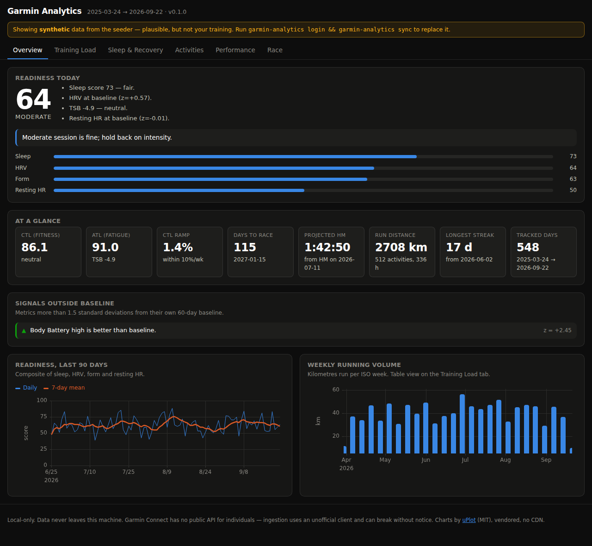

# Garmin Analytics

Personal analytics over Garmin Connect data — training load, recovery trends,
performance and race readiness — running entirely on this machine.

Built for one athlete training for the **half marathon at the Doha Marathon by Ooredoo,
Friday 15 January 2027, 07:35** (`garmin_analytics/config.py`).

Nothing leaves the machine. There is no telemetry, no cloud component, and the frontend
has no CDN links.

---

## Why this exists

Garmin has no self-serve API for individuals — the Connect Developer Program
(Health/Activity/Training API) is enterprise-only. And Strava, the usual escape hatch,
never receives sleep, HRV, Body Battery, stress or training readiness. That data is the
whole point of this app, so it reads from Garmin Connect directly.

The analytics are the kind a coach would actually use: Banister TRIMP summed over
heart-rate zones, CTL/ATL/TSB, z-scores against the athlete's *own* rolling baseline,
best efforts extracted from sample streams, aerobic decoupling, and a Riegel race
projection that shows its working.

---

## Quick start

```bash
# 1. Environment (see "Installing" below if python3-venv is missing)
python3 -m venv .venv
.venv/bin/python -m pip install -r requirements.txt

# 2. Demo data — 18 months of synthetic, physiologically coherent training
.venv/bin/python -m garmin_analytics.cli seed --reset

# 3. Run it
.venv/bin/python -m garmin_analytics.cli serve
# → http://127.0.0.1:8808/
```

To connect the real account instead, see **HANDOVER.md**. Short version:

```bash
.venv/bin/python -m garmin_analytics.cli login
.venv/bin/python -m garmin_analytics.cli sync --days 540
```

---

## Installing

This box has no `python3-venv`, so `python3 -m venv .venv` fails at the ensurepip step.
The workaround, which also leaves pip inside the venv:

```bash
python3 -m venv --without-pip .venv
python3 -m pip --python .venv/bin/python install -r requirements.txt
```

If `python3-venv` *is* available, the normal `python3 -m venv .venv` works fine.

Installing the package itself (`pip install -e .`) puts a `garmin-analytics` command on
the path; everything below also works as `python -m garmin_analytics.cli <command>`.

Dependencies are pinned in `requirements.txt`. The whole virtualenv is ~100 MB: no
numpy, no pandas, no node_modules, no Docker.

---

## Commands

| Command | What it does |
|---|---|
| `login` | One-time Garmin Connect SSO. Prompts for the password on a tty, never stores it. Writes an OAuth token cache to `~/.garminconnect/` at mode 0600. |
| `sync` | Incremental pull from Connect. Resumes from the per-endpoint watermark minus three days of overlap. Safe to interrupt and re-run. |
| `renormalize` | Re-parse everything already in `raw_documents`. **No network.** Use after a parser fix. |
| `import-zip <path>` | Load Garmin's official "Export Your Data" ZIP. No credentials needed. |
| `import-fit <paths…>` | Load `.fit` files or a directory of them (recursively). |
| `seed` | Generate synthetic data for demos and tests. `--reset` wipes first. |
| `serve` | Run the API and dashboard. Binds `127.0.0.1` by default. |
| `doctor` | Report environment, dependency, database and auth status. |
| `report` | Print today's readiness, load and race outlook in the terminal. |

Useful flags:

```bash
sync --days 540 --endpoints sleep,hrv     # subset of endpoints
sync --no-activities                       # wellness only
seed --months 6 --end 2026-09-22 --reset
serve --port 9000 --host 0.0.0.0           # see the warning in "Limits"
doctor --json | jq .overall
report --json
```

Every command accepts `--json` for machine-readable output.

---

## Dashboard

Single page, six tabs, dark, readable on a phone.

- **Overview** — readiness hero with its component breakdown and plain-English reasons,
  headline stats, out-of-baseline signals, readiness history, weekly volume.
- **Training Load** — CTL vs ATL, TSB (diverging around zero), daily TRIMP, weekly table.
- **Sleep & Recovery** — baselines with z-scores, sleep stages, sleep score, HRV,
  resting HR and Body Battery, each against a 28-day mean; monthly table.
- **Activities** — sortable, filterable table (type, name, date range) with a per-activity
  drawer: HR and pace traces, HR-zone breakdown, kilometre splits, best efforts, and a
  link to the verbatim archived payload.
- **Performance** — best efforts per distance, aerobic decoupling against the 5 % line,
  efficiency factor, VO₂max.
- **Race** — countdown, Riegel projection with its source effort named, CTL trajectory
  against target, weekly kilometres against target.

Charts are [uPlot](https://github.com/leeoniya/uPlot) 1.6.32 (MIT), vendored into
`garmin_analytics/web/vendor/`. No CDN, no build step, no framework.

Screenshots of every tab, rendered from the synthetic seed, are in
[`docs/screenshots/`](docs/screenshots/).



---

## Data model

SQLite, one file, stdlib `sqlite3`. Full DDL in `garmin_analytics/db/schema.sql`.

### Raw-first archive

| Table | Purpose |
|---|---|
| `raw_documents` | Every fetched payload, verbatim, with a content hash. Unique on `(source, endpoint, ref_key, content_hash)`, so re-ingesting an unchanged payload is a no-op and a *changed* one is kept as a new revision. **Nothing Garmin returns is ever discarded**, modelled or not. |
| `sync_watermark` | Per-endpoint progress, status and note. Drives incremental sync. |

Every normalised row carries `raw_id` back to the document it came from. That is what
makes `renormalize` possible: a parser bug is fixed offline, never by re-fetching
18 months.

### Normalised tables

| Table | Grain | Notable columns |
|---|---|---|
| `activities` | one activity | distance, elapsed/moving time, avg/max HR, avg/max speed, elevation, calories, cadence, power, aerobic/anaerobic training effect, `trimp` |
| `activity_hr_zones` | activity × zone | seconds in zones 1–5 |
| `activity_samples` | activity × 10 s | distance, HR, speed, cadence, power, altitude |
| `best_efforts` | activity × distance | fastest window for 1 k, 1 mile, 5 k, 10 k, 15 k, HM, M |
| `sleep` | day | total/deep/light/REM/awake, score, overnight HRV, respiration, SpO₂, bed/wake |
| `daily_wellness` | day | resting HR, steps, floors, calories, intensity minutes, stress, Body Battery |
| `hrv_daily` | day | last-night avg, 5-min high, weekly avg, baseline band, status |
| `fitness` | day | VO₂max run/cycle, training status, training readiness, acute/chronic load |
| `body_composition` | day | weight, body fat %, BMI |
| `v_daily` (view) | day | everything above joined — what the trend engine reads |

Units are normalised on the way in: seconds, metres, m/s, kilograms. The GDPR export
uses centimetres, milliseconds and grams; `normalize_export_activity` converts them.

---

## The analytics

### Training load — `analytics/load.py`

**TRIMP** (Banister): `duration_min × HRr × 0.64 × e^(k·HRr)`, where
`HRr = (HR − HR_rest) / (HR_max − HR_rest)` and `k` is 1.92 (male) or 1.67 (female).

Where HR-zone dwell times exist, TRIMP is summed *per zone* using the zone midpoint,
not computed from the session's mean HR. That matters: the formula is exponential in
intensity, so flattening an interval session to one average under-counts it.

**CTL** is a 42-day EWMA of daily TRIMP, **ATL** a 7-day EWMA, both with
`α = 1 − e^(−1/τ)`. Rest days are zeros in a dense series — the decay on rest days *is*
the model, so gaps cannot be skipped.

**TSB = CTL − ATL**, same day. (TrainingPeaks uses yesterday's values; the difference is
a one-day shift. Stated rather than silently chosen — DECISIONS.md D6.)

**Ramp rate** is the percent change in CTL over seven days; over 10 %/week is flagged.
The weekly over-training flag is also on the CTL ramp, not on raw weekly load — a
3-weeks-build/1-week-recover cycle swings raw load ±40 % by design, and flagging that
would cry wolf every fourth week.

CTL starts from zero, so the first 42 days of any series ramp steeply no matter what the
athlete did. The API returns `warmup_until` and the chart says so.

### Trends — `analytics/trends.py`

7/28/90-day rolling means, plus a z-score of today against a trailing 60-day baseline
that **excludes today**. Beyond ±1.5σ is flagged. Each metric knows which direction is
good (resting HR down, HRV up), so the same +2σ reads as "worse" for RHR and "better"
for HRV. A zero-variance baseline returns `None` rather than a fake z.

This is the early-illness / overreaching signal: absolute values are useless, deviation
from your own baseline is not.

### Performance — `analytics/performance.py`

**Best efforts** are the fastest *continuous window* for each distance inside a sample
stream, found with a two-pointer sweep and linear interpolation at the entry point —
not whole-activity averages, and not quantised to the sample interval.

**Aerobic decoupling**: speed-per-heartbeat in the first half versus the second, split
at the elapsed midpoint, for runs over 40 minutes. HR is time-weighted, so irregular
sampling doesn't bias it. Under 5 % means the aerobic base supports that effort.

**Efficiency factor**: metres per minute per bpm. Rising at the same effort is fitness.

### Readiness — `analytics/readiness.py`

A transparent weighted sum, 0–100: sleep 0.30, HRV z 0.25, TSB 0.25, resting-HR z 0.20.
Components with no data are dropped and the remaining weights renormalised, so a missing
HRV night lowers confidence rather than scoring a hard zero. Every component emits its
own sentence, and the API returns all of them alongside the number.

### Race panel — `analytics/readiness.py`

Days to 2027-01-15, a **Riegel** projection (`T₂ = T₁ · (D₂/D₁)^1.06`) from the *longest*
qualifying best effort in the last 120 days — projecting a half marathon from a 1 k
flatters badly — CTL trajectory against a peak target, and 28-day average weekly
kilometres against target. The projection names the effort it came from, so the number
is auditable.

### Reports — `analytics/reports.py`

Weekly and monthly rollups (ISO weeks, not SQLite's `%Y-%W`, which disagrees at year
boundaries), longest and current streaks, weekday consistency, month-over-month deltas.
Running kilometres are reported separately from all-sport kilometres.

---

## API

All JSON, all read-only, all on `127.0.0.1`.

| Endpoint | Returns |
|---|---|
| `GET /api/health` | status, version, day range, whether the data is synthetic |
| `GET /api/config` | race details, athlete HR settings, plan targets |
| `GET /api/doctor` | the same checks as the `doctor` command |
| `GET /api/summary` | everything the Overview tab needs, in one round trip |
| `GET /api/load?start=&end=` | daily CTL/ATL/TSB curve, weekly rollup, ramp rate |
| `GET /api/trends?days=&metrics=` | rolling means and z-scores per metric |
| `GET /api/readiness?day=` | today's composite with its components and reasons |
| `GET /api/readiness/history?days=` | the same score back through `days` |
| `GET /api/performance` | best efforts, decoupling, efficiency factor, VO₂max |
| `GET /api/race` | countdown, projection, CTL and volume against target |
| `GET /api/reports` | weekly/monthly rollups, streaks, consistency, totals |
| `GET /api/daily?days=` | the joined daily frame |
| `GET /api/activities?…` | filterable, sortable, paged list |
| `GET /api/activities/{id}` | one activity with zones, splits, best efforts, samples |
| `GET /api/raw/{endpoint}/{ref_key}` | the verbatim archived payload |

Sort keys are allow-listed rather than interpolated; all filters are parameterised.
A full curl transcript of every endpoint is in **VERIFICATION.md**.

---

## Tests

```bash
.venv/bin/python -m pytest -q     # 454 tests, ~30 s
```

The analytics tests derive their expected values on paper in the docstring beside each
assertion — TRIMP 108.09535934, Riegel 5 520.2392 s, CTL day 3 6.89372203, decoupling
8.396946565 % — so a failure tells you which step of the formula moved.

`tests/fitgen.py` writes a real FIT binary (header, definition and data messages, both
CRCs) that the actual `fitdecode` then parses, so the FIT path is tested end-to-end
rather than against stub objects.

`tests/test_dashboard.py` asserts that no asset is off-machine, that every element id
`app.js` reaches for exists, that every `/api` path it calls returns 200 — and, where
Chromium is installed, renders the page headlessly and checks that the JS bootstrapped
and uPlot drew canvases.

---

## Limits — read these

- **The Connect API is unofficial.** Garmin publishes no API for individuals. This talks
  to the endpoints the mobile app uses, via `garth`. Garmin can change or block them
  without notice, and doing so is arguably against their terms of service. Use your own
  account, for your own data, at your own risk.
- **`garth` is deprecated upstream.** `garth==0.8.0` prints
  `DeprecationWarning: Garth is deprecated and no longer maintained`
  (matin/garth discussion #222). It works today. The blast radius is contained: all
  Connect calls go through `ingest/connect.py`, whose endpoint paths are literals in one
  dict, and every payload is archived raw, so a transport swap costs new fetches, not
  history. See DECISIONS.md D3.
- **Rate limits are real.** Requests are paced at ~0.6 s and daily endpoints are fetched
  one calendar day at a time, with backoff on 429. A first 540-day backfill therefore
  takes a while (see HANDOVER.md). Hammering this gets accounts throttled.
- **The live login path is untested.** There were no credentials on the machine this was
  built on. Everything downstream of the HTTP call is tested; `garth.login` itself is not.
- **The export-ZIP importer has never seen a real export.** It routes documents by shape
  rather than by path precisely because the layout changes, but it has only been run
  against a synthetic archive.
- **VO₂max, training status and training readiness are Garmin's estimates**, not
  measurements. The trend is worth something; the absolute number is decoration.
- **TRIMP, CTL and TSB are models.** They are useful for spotting ramp and fatigue
  patterns. They are not a training plan and they are not medical advice.
- **`serve --host 0.0.0.0` exposes personal health data with no authentication.** The
  default is loopback for a reason. If you must expose it, put it behind something.
- **Synthetic data is labelled everywhere.** `doctor` warns, `/api/health` returns
  `synthetic: true`, and the dashboard shows a banner. If you see that banner, you are
  not looking at your own training.

---

## Layout

```
garmin_analytics/
  cli.py              login | sync | renormalize | import-zip | import-fit
                      | seed | serve | doctor | report
  config.py           paths, race constants, athlete defaults
  diagnostics.py      the doctor checks
  db/
    schema.sql        DDL
    store.py          connection, migrate(), idempotent upserts, raw archive
  ingest/
    connect.py        garth-backed Connect client (endpoint paths live here)
    export_zip.py     GDPR export parser, routes by shape not by path
    fitfile.py        fitdecode → activity + sample stream
    normalize.py      raw JSON → typed rows
  analytics/
    load.py           TRIMP, CTL, ATL, TSB, ramp rate
    trends.py         rolling baselines, z-scores, flags
    performance.py    best efforts, Riegel, decoupling, efficiency factor
    readiness.py      composite readiness + race panel
    reports.py        weekly/monthly rollups, streaks, consistency
  api/server.py       FastAPI: JSON endpoints + static mount
  seed/synthetic.py   18 months of physiologically coherent fake data
  web/                index.html, app.js, style.css, vendor/uPlot
scripts/verify.sh     regenerates VERIFICATION.md end to end
tests/                454 tests, incl. a real FIT writer and a headless render
```

- **HANDOVER.md** — exactly what to run to connect the real account.
- **DECISIONS.md** — every judgement call made during the build, with reasons.
- **VERIFICATION.md** — captured transcript of the full end-to-end run.
