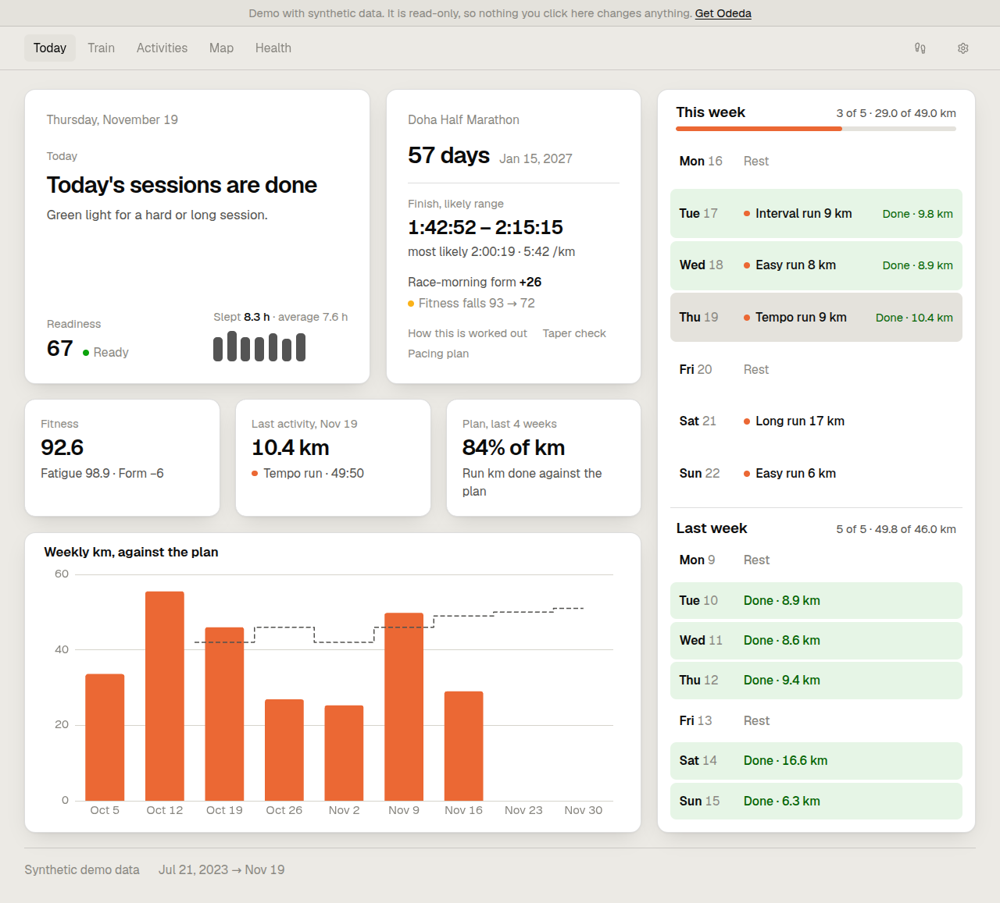

# Garmin Analytics

**Your Garmin history, on your own machine, with the questions answered first.**

Self-hosted analytics over **your own** Garmin Connect account. It turns years of
activities into the things Garmin's app does not show you: the route you have run 163
times and where on it you speed up, a training plan judged session by session, a race
countdown with a finish range, and every edit you make surviving every sync.

One deployment is one person's data. There is no account system, no shared database, and
nobody else's Garmin password anywhere.

<!-- Screenshot slot: docs/img/today.png. The Today page, the first thing you see. -->
<!--  -->

## What you get

| Page | The question it answers |
|---|---|
| **Today** | What is today's session, how ready am I, and how many days to the race? |
| **Train** | Am I on plan? Four tabs: the **Plan** judged week by week, the **Race** with a finish range and a pacing plan, the **Load** (fitness, fatigue, form) and the **Trends** over the years. |
| **Activities** | What happened on that run, ride or gym session? Maps, heart-rate zones, splits, the watch's laps against the plan, weather and wind, a 3D flyover with MP4 export, editing, and comparing two to five. |
| **Map** | Where do I go? Your routes clustered into the loops you actually run, segment analysis along each, and a lifetime heat map. |
| **Health** | Am I recovering? Sleep, HRV, resting heart rate, Body Battery, weight and body composition against your own baselines. |
| **Gear** | When do these shoes retire? Mileage per pair or bike, with bulk reassign. It sits behind the corner icon, beside Settings. |

More detail on each: [what it does](docs/features.md).

## Quickstart

You need [Docker](https://docs.docker.com/get-docker/) and a Garmin Connect account.

```bash
git clone https://github.com/mshinoy/garmin-analytics.git
cd garmin-analytics
cp .env.example .env
$EDITOR .env                 # optional: APP_PASSWORD and TZ. Settings can set both later
docker compose up -d
```

Open <http://127.0.0.1:8000>. A new install opens on a short checklist; every step is in
**Settings** (the icon in the corner):

1. **Check the basics:** your time zone and heart-rate limits, and a password if `.env` has
   none. Every load number is worked out from the heart rates.
2. **Sign in to Garmin.** Your password is used once to get a token and is never stored.
   If Garmin refuses the login there is a browser sign-in that always works, see
   [signing in to Garmin](docs/connecting-garmin.md#signing-in-to-garmin).
3. **Start the sync.** It shows how many requests and how long it will take before you
   commit. It pulls everything back to the start of your account, is safe to stop, and
   resumes where it stopped.

After that the app syncs itself every six hours.

**Just looking around first?** Set `GA_SEED_DEMO=1` in `.env` before the first start for
three years of synthetic data. Wipe it before connecting a real account, or the two sit
side by side:
`docker compose down && docker volume rm garmin-analytics-data`, set `GA_SEED_DEMO=0`,
then `docker compose up -d`.

No Python or Node on the host, and no database to provision. Without Docker, and the
other ways in (Garmin's data export, `.fit` files, a Fitbit-connected scale):
[getting your data in](docs/connecting-garmin.md) and
[configuration](docs/configuration.md).

## How it works

* **Raw first.** Everything fetched is archived verbatim before it is read, so a better
  parser never means fetching again. `garmin-analytics renormalize` rebuilds every table
  from the archive with no network.
* **Your edits win.** Garmin's values and yours live in separate tables, and nothing in
  the sync touches yours. Every edit can be reverted to what Garmin said.
* **Routes by shape.** Tracks are compared by the ground they cover, not by their start
  or their name, so a short out-and-back is not swallowed by the longer loop around it.
* **One origin.** A FastAPI backend and a React app served from the same container, over
  SQLite. See [architecture](docs/architecture.md).

## Honest limits

* **The Garmin client is unofficial.** It signs in as you the way the website does. It is
  not a supported API, it may be against Garmin's terms, and it can break without
  notice when Garmin changes something. Upgrading the pin in `requirements.txt` is the
  first thing to try.
* **Garmin may refuse a sign-in from a server.** The browser sign-in is the way around it.
* **Single-user.** There is no multi-user support and none is planned. Run your own.
* **The password is one shared secret with no lockout.** Fine on localhost or a VPN, not
  on an open port. Use a long random password and a reverse proxy if you expose it.
* **The basemap comes from a third party** (CARTO, or Mapbox if you add a token). The rest
  is served from your container.
* **It is young.** It has run for two months against one real account, 500 activities back to
  December 2022. Months of uptime, ARM builds and very large databases are untested.

The full list: [honest limits](docs/honest-limits.md).

## Documentation

| | |
|---|---|
| [What it does](docs/features.md) | Routes, edits, gear and aggregates in detail |
| [Getting your data in](docs/connecting-garmin.md) | Backfill, sign-in trouble, export files, a Fitbit scale |
| [Configuration](docs/configuration.md) | Settings, the command line, backups, running without Docker |
| [Architecture](docs/architecture.md) | The pieces, the data model, security notes |
| [Honest limits](docs/honest-limits.md) | What it cannot do and what can go wrong |
| [CONTRIBUTING.md](CONTRIBUTING.md) | Development setup, tests, how work is planned |
| [CHANGELOG.md](CHANGELOG.md) | What changed in each release |

FastAPI's interactive docs are at `/docs` on a running instance, behind the same sign-in.

## Contributing

Small and single-tenant on purpose: the fastest change to merge is one that fits that
shape. Start with [CONTRIBUTING.md](CONTRIBUTING.md). If ingestion breaks, the useful
report includes the output of `garmin-analytics doctor`, which holds no credentials.

## Licence

MIT, see [LICENSE](LICENSE). Frontend dependencies are installed from npm under their own
licences. The default basemap styles are CARTO's, with OpenStreetMap data, and their
attribution terms apply.

Not affiliated with, endorsed by, or supported by Garmin.
