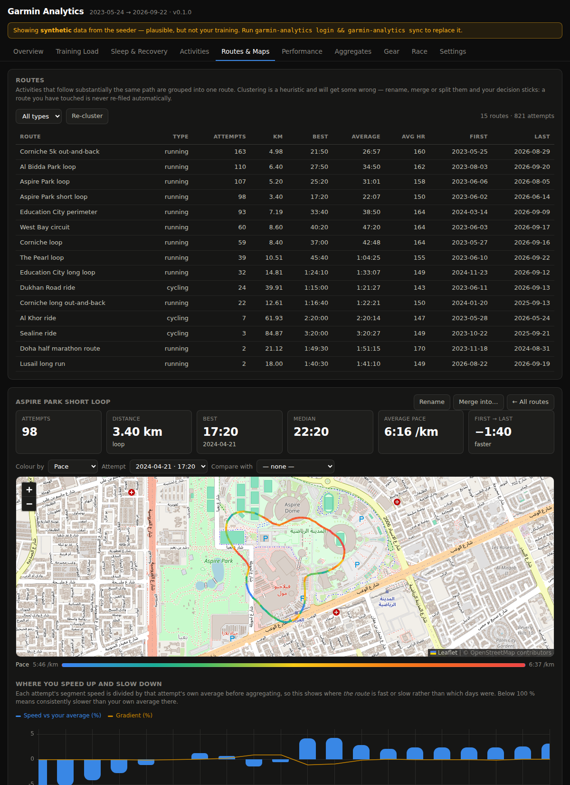
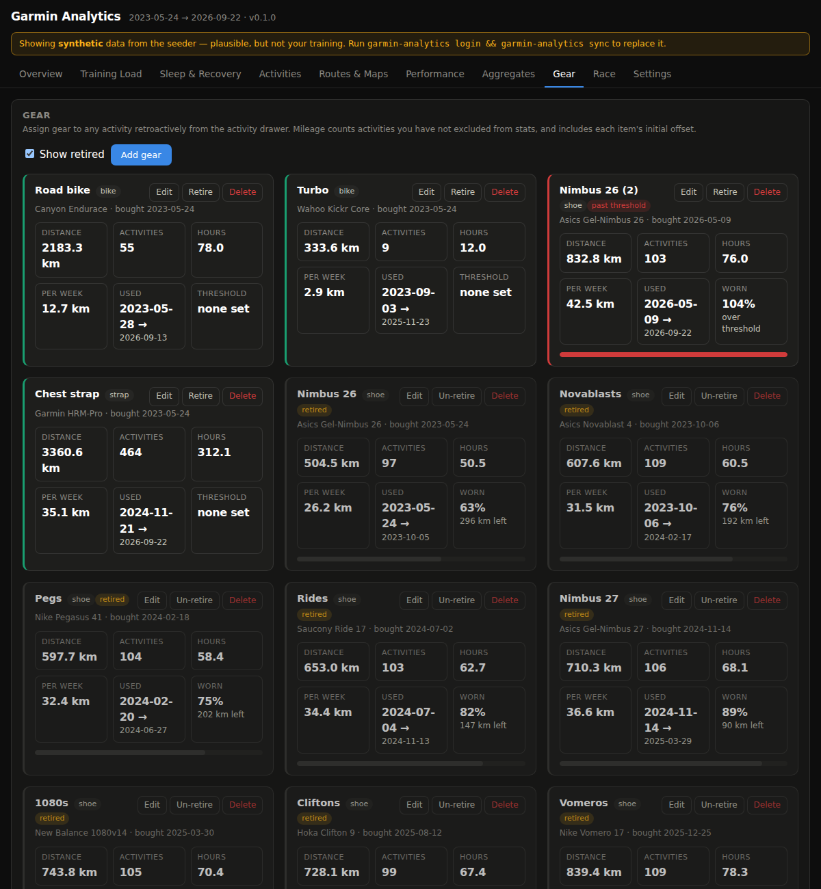
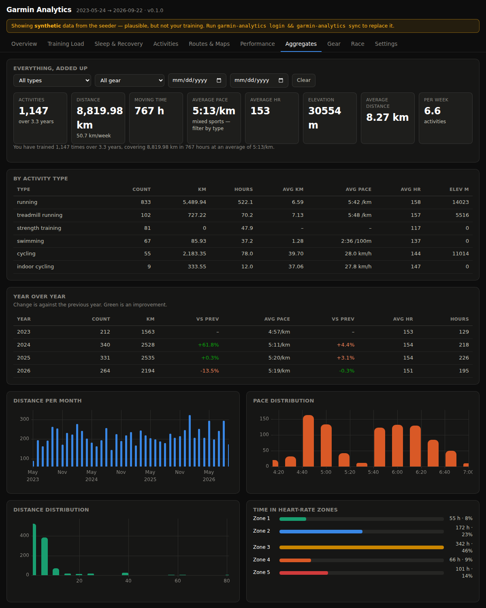

# Garmin Analytics

Self-hosted analytics over **your own** Garmin Connect history. Clone it, bring your
account, get your data — routes clustered into the loops you actually run, segment
analysis showing where you speed up and slow down, gear mileage, training load,
recovery trends, and lifetime aggregates over every activity you have ever recorded.

Single-tenant by design: one deployment is one person's data. There is no user
account system, no shared database, and nobody else's Garmin password anywhere.



> Every screenshot in this repository is of **synthetic data** from the built-in
> seeder. No real training, no real GPS traces, no real names.

---

## 60-second quickstart

```bash
git clone https://github.com/<you>/garmin-analytics.git
cd garmin-analytics
cp .env.example .env
$EDITOR .env                 # set APP_PASSWORD, and GA_SEED_DEMO=1 to look around first
docker compose up -d
```

Open <http://127.0.0.1:8000>, sign in with `APP_PASSWORD`, then go to **Settings →
Garmin account** and connect your account. Your Garmin password is used once to
obtain a token and is never stored.

Then **Settings → Sync → Start full backfill**. It tells you how many requests it
expects and roughly how long they will take before you commit to it.

That is the whole install. No Python on the host, no database to provision.

<details>
<summary>Running without Docker</summary>

```bash
python -m venv .venv && . .venv/bin/activate
pip install -r requirements.txt && pip install -e .

garmin-analytics seed --reset      # ~3 years of synthetic data, no account needed
garmin-analytics serve             # http://127.0.0.1:8808
```

For a real account: `garmin-analytics login`, then `garmin-analytics backfill`.
</details>

---

## What it does

### Routes and maps

This is the part that does not exist elsewhere. Garmin shows you 163 unrelated
activities; what you actually have is **one route you have run 163 times**.

* **Clustering.** Tracks are resampled to a fixed number of points *by distance*, so
  a slow run and a fast run of the same loop line up. Two tracks are compared by
  symmetric path overlap — the fraction of each lying within 45 m of the other,
  taking the worse of the two, which is what stops a 5 km out-and-back being
  swallowed by the 10 km route that contains it.
* **Clustering gets some wrong, so you can fix it.** Rename, merge, split, or move a
  single activity. A route you have touched is *pinned* and never re-filed
  automatically.
* **Segment analysis** — the headline. Each attempt is split into fixed segments
  (200 m / 500 m / 1 km depending on route length), and each segment's speed is
  divided by *that attempt's own average* before aggregating. So the profile shows
  where **the route** is fast or slow rather than which days were, with median HR,
  gradient and cadence alongside. The hills and the fade points show up as exactly
  what they are.
* **Maps.** Polyline coloured by pace, heart rate, elevation or gradient; a second
  attempt overlaid for comparison; a lifetime heatmap of every GPS point; and hover
  linking that works **both ways** — move along the chart and a marker tracks the
  route, move over the map and the chart's crosshair follows.
* **Indoor activities degrade gracefully.** A treadmill run has no route and no map,
  and everything else on the page still works.

### Your edits survive every sync

Garmin gets things wrong. The design point:

```
activities   ← what Garmin said.   A sync rewrites this freely.
overrides    ← what you said.      Nothing in the sync path touches it.
v_activities ← COALESCE(override, garmin_value).  Everything reads this.
```

A sync *cannot* clobber an edit, because there is no code path where it would even
look at the overrides table. Every edit is timestamped and revertible to the value
Garmin supplied. Editable: title, activity type, notes, RPE, private, and
exclude-from-stats — for the time you left the watch running in the car.

Adding another editable field is [one entry in a registry](garmin_analytics/db/fields.py);
the view DDL, the API schema, validation and the UI editor are all generated from it.

### Gear



Shoes, bikes, straps — brand, model, nickname, purchase date, an initial distance
offset for mileage they already had, and a retirement threshold with a warning state.

* Assign gear to **any** activity from a dropdown, retroactively, at any time.
* **Bulk reassign** across a date range and activity type — the only sane way to add
  gear to years of imported history that has none. Preview tells you how many
  activities it would touch before you commit.
* Default gear per activity type, applied to **new** activities only — backfilling
  four years of history with today's shoes would simply be a lie.
* Mileage counts activities you have not excluded from stats, so a bad GPS fix does
  not retire your shoes early.

### Aggregates



Lifetime and per-period, filterable by type, date range and gear: totals, "you have
run 833 times over 3.3 years at an average of 5:42/km", pace / distance / duration
histograms, HR-zone split, day-of-week and time-of-day heatmaps, seasonality,
consistency streaks, a records wall, and year-over-year change on every headline
metric.

Average pace is **distance-weighted** (total distance over total time), not the mean
of per-activity paces — otherwise a 400 m stride counts as much as a 30 km long run.

### And the rest

Training load (TRIMP → CTL/ATL/TSB with ramp-rate warnings), recovery trends against
rolling baselines (RHR, HRV, sleep, Body Battery) with anomaly flags, rolling best
efforts, aerobic decoupling, efficiency factor, VO2max, and a race panel with a
Riegel projection.

---

## How data gets in

Garmin has **no self-serve API for individuals** — the Connect Developer Program is
enterprise-only. So there are three routes in, in order of convenience:

| Path | What it needs | What you get |
|---|---|---|
| `garth` (default) | Your Garmin login, via the web UI | Everything, including sleep, HRV, Body Battery, stress, training readiness |
| Official data export | Garmin's GDPR export ZIP, no credentials | Most of it, as a one-off |
| `.fit` / `.gpx` / `.tcx` | The files themselves | Full per-second streams including GPS |

**The backfill pulls everything, back to the start of your account** — not a recent
window. For a multi-year account that is thousands of requests, so it:

* rate-limits politely and backs off exponentially on HTTP 429;
* **checkpoints after every single activity**, and derives its work queue from the
  database rather than an in-memory list, so killing it at request 4 000 of 6 000
  and re-running resumes at 4 001;
* reports progress, rate and ETA to stdout *and* to `/api/sync/status`, which the
  Settings tab polls;
* is safely re-runnable — archived payloads dedupe on content hash.

Raw payloads are archived **verbatim** before anything is normalised, so improving a
parser never means re-fetching. `garmin-analytics renormalize` rebuilds every table
from the archive with no network access at all.

---

## Honest limits

Read this part.

* **The Garmin client is unofficial.** [`garth`](https://github.com/matin/garth)
  logs in as you through the same SSO flow the website uses. It is not a supported
  API, it is arguably against Garmin's terms of service, and **it can break without
  notice** when Garmin changes something. Upstream has also announced it is no longer
  maintained. If ingestion stops working, that is the most likely reason.
* **Rate limits are real and undocumented.** A first full backfill of a multi-year
  account issues thousands of requests. Do not run it repeatedly; it is resumable
  precisely so that you do not have to.
* **Map tiles are the one external call at runtime.** Every application asset —
  Leaflet, uPlot, CSS, the lot — is vendored and served from the container. When a
  map is on screen, raster tiles are fetched from the configured tile server
  (OpenStreetMap by default). Point `GA_TILE_URL` at your own to remove even that,
  and respect [the OSM tile usage policy](https://operations.osmfoundation.org/policies/tiles/)
  if you use theirs.
* **Single-tenant.** There is no multi-user support and none is planned. Run your own
  container.
* **`APP_PASSWORD` is one shared password, not an identity system.** It stops the
  port being wide open. It is not a substitute for not exposing the port.
* **This is a POC, freshly built.** It has 645 tests and a verification transcript,
  but it has not been run against a real Garmin account for months on end.

---

## Data model

SQLite on a Docker volume. Stdlib `sqlite3`, no ORM.

```
raw_documents          verbatim payloads, deduped on content hash — the source of truth
activities             what Garmin said (a sync rewrites this)
activity_samples       per-sample streams: distance, HR, speed, cadence, altitude, lat/lon
overrides              what you said, per (activity, field) — a sync never touches it
v_activities           COALESCE(override, garmin_value) — what everything reads
v_activities_included  the same, minus anything excluded from stats — what aggregates read
gear, activity_gear    gear and its many-to-many assignment, with gear_defaults
routes, route_members  clusters of activities that follow the same path
route_segment_efforts  per-attempt, per-segment splits, cached
sleep, daily_wellness, hrv_daily, fitness, body_composition     per-day wellness
best_efforts           rolling best efforts extracted from sample streams
sync_status            resumable backfill progress, polled by the UI
sessions, app_settings session cookies (hashed) and the app password hash (PBKDF2)
```

Full DDL: [`garmin_analytics/db/schema.sql`](garmin_analytics/db/schema.sql).

---

## Configuration

Every setting is documented in [`.env.example`](.env.example). The ones that matter:

| Variable | Default | Notes |
|---|---|---|
| `APP_PASSWORD` | *(empty)* | **Set this.** Empty means no authentication at all. |
| `GA_COOKIE_SECURE` | `0` | Set to `1` when behind HTTPS. |
| `GA_SEED_DEMO` | `0` | `1` generates synthetic data on first start. |
| `GA_TILE_URL` | OSM | Your own tile server goes here. |
| `GA_HR_REST` / `GA_HR_MAX` | 52 / 187 | Used by TRIMP and zone maths. |

There is deliberately **no** `GARMIN_EMAIL` / `GARMIN_PASSWORD`. Credentials are
entered in the web UI, exchanged for a token, and discarded.

---

## CLI

```
garmin-analytics login          authenticate with Garmin Connect (once)
garmin-analytics backfill       pull EVERYTHING back to the start of the account
garmin-analytics backfill --estimate    size the job before starting it
garmin-analytics sync           incremental pull
garmin-analytics renormalize    re-parse the raw archive, no network
garmin-analytics cluster        (re)group GPS activities into routes
garmin-analytics import-zip     load Garmin's official data-export ZIP
garmin-analytics import-fit     load .fit files
garmin-analytics seed --reset   synthetic data for demos and tests
garmin-analytics serve          run the API and dashboard
garmin-analytics doctor         environment and data status (no credentials printed)
garmin-analytics report         today's readiness, load and race outlook
```

Inside Docker: `docker compose exec app garmin-analytics doctor`.

---

## Security notes

* `APP_PASSWORD` is stored **only** as a salted PBKDF2-SHA256 hash (240 000 rounds).
* Session cookies are 256-bit random tokens; only their SHA-256 hash is stored, so a
  copy of the database cannot be replayed as a live session. Cookies are `HttpOnly`
  and `SameSite=Lax`.
* The Garmin token cache lives on the volume at mode 0600, never in an image layer.
* The container runs as a non-root user (uid 10001) with `no-new-privileges`.
* Compose binds the port to `127.0.0.1` by default.
* `.gitignore` and `.dockerignore` both cover `.env`, token caches, databases and
  activity files.

---

## Development

See [CONTRIBUTING.md](CONTRIBUTING.md). Short version:

```bash
pip install -r requirements.txt && pip install -e .
garmin-analytics seed --reset     # no Garmin account needed to develop
pytest                            # 645 tests
./scripts/verify.sh               # local end-to-end transcript
./scripts/verify_docker.sh        # container transcript (destroys the volume)
```

The seeder produces physiologically coupled data — an athlete model run forward day
by day, with an illness block, a travel block, cardiac drift, and **repeated GPS
routes with fixed hills** so that clustering and segment analysis have something real
to work on.

[`VERIFICATION.md`](VERIFICATION.md) records what was actually observed, including
what was *not* verified.

---

## Licence

MIT — see [LICENSE](LICENSE). Vendored: [uPlot](https://github.com/leeoniya/uPlot)
(MIT) and [Leaflet](https://leafletjs.com/) (BSD-2-Clause).

Not affiliated with, endorsed by, or supported by Garmin.
